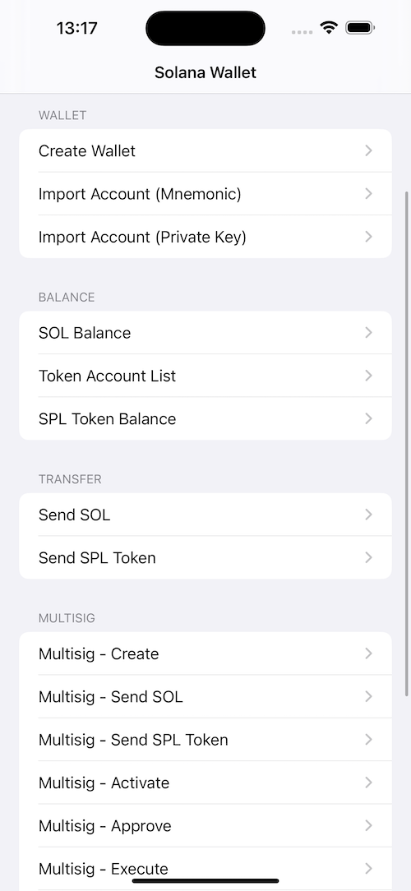

# SolanaWeb

**SolanaWeb** is a Swift library for interacting with the Solana network on iOS and macOS. It uses a WebKit-based JavaScript bridge to perform wallet operations, balance queries, SOL/SPL token transfers, message signing, and multisig flows.


[](https://www.swift.org/getting-started/#using-the-package-manager)




For full app examples, see the [Demo](https://github.com/Elizabet1926/Solana/tree/master/Demo) project.

---

## Important note on RPC nodes

The public node `https://solana.maiziqianbao.net/` has been used for testing SOL transfers, SPL token transfers, and other features; all succeeded. SPL token transfers on this node can be slow (~20 seconds). For production, consider using a dedicated RPC provider (e.g. [QuickNode](https://www.quicknode.com/)).

---

## Installation

### Swift Package Manager

Add to your `Package.swift` or Xcode:

```swift
dependencies: [
    .package(url: "https://github.com/Elizabet1926/Solana.git", .upToNextMajor(from: "1.1.0"))
]
```

Then add the **SolanaWeb** target to your app target.

---

## Quick start

```swift
import SolanaWeb

let solanaWeb = SolanaWeb()
solanaWeb.setup(showLog: true) { success in
    if success {
        // Use solanaWeb for wallet, balance, transfer, etc.
    }
}
```

All methods return results in a `[String: Any]?` dictionary. Check for an `"error"` key for failures; success keys vary by method (e.g. `"signature"`, `"address"`, `"mnemonic"`).

---

## Constants

### Main net RPC URLs

```swift
SolanaMainNet1  // https://solana.maiziqianbao.net
SolanaMainNet2  // https://api.mainnet-beta.solana.com
SolanaMainNet3  // https://solana-api.projectserum.com
SolanaMainNet4  // https://rpc.ankr.com/solana
```

### SPL token mints

```swift
SPLToken.USDT.rawValue  // Es9vMFrzaCERmJfrF4H2FYD4KCoNkY11McCe8BenwNYB
SPLToken.USDC.rawValue  // EPjFWdd5AufqSSqeM2qN1xzybapC8G4wEGGkZwyTDt1v
```

---

## Setup

| Method | Description |
|--------|-------------|
| `setup(showLog:onCompleted:)` | Loads the internal WebView and registers the JS bridge. Call once before using other APIs. `onCompleted(Bool)` is called when the bridge is ready. |
| `isGenerateSolanaWebInstanceSuccess` | `true` after the JS bridge has reported success (e.g. after first `setup` completion). |

**Example**

```swift
let solanaWeb = SolanaWeb()
solanaWeb.setup(showLog: true) { success in
    if success {
        // Ready to call createWallet, getSOLBalance, sendSOL, etc.
    }
}
```

---

## Wallet management

| Method | Description |
|--------|-------------|
| `createWallet(wordCount:language:completion:)` | Creates a new wallet. **wordCount**: 12, 15, 18, 21, or 24. **language**: e.g. `"en"`, `"zh-CN"`, `"ja"`. Returns address, privateKey, mnemonic, etc. in the response dictionary. |
| `createWalletAsync(wordCount:language:)` | Async version of `createWallet`. |
| `importAccountFromMnemonic(mnemonic:completion:)` | Imports an account from a BIP39 mnemonic phrase. |
| `importAccountFromMnemonicAsync(mnemonic:)` | Async version of `importAccountFromMnemonic`. |
| `importAccountFromPrivateKey(privateKey:completion:)` | Imports an account from a base58 private key. |
| `importAccountFromPrivateKeyAsync(privateKey:)` | Async version of `importAccountFromPrivateKey`. |

**Example (create wallet)**

```swift
solanaWeb.createWallet(wordCount: 12, language: "en") { response in
    guard let r = response else { return }
    if let err = r["error"] as? String {
        print("Error: \(err)"); return
    }
    let address = r["address"] as? String
    let privateKey = r["privateKey"] as? String
    let mnemonic = r["mnemonic"] as? String
    // ...
}
```

---

## Balance

| Method | Description |
|--------|-------------|
| `getSOLBalance(address:endpoint:completion:)` | Gets SOL balance for a given address. **endpoint**: RPC URL (e.g. from your config). |
| `getSOLBalanceAsync(address:endpoint:)` | Async version of `getSOLBalance`. |
| `getSPLTokenBalance(address:mint:endpoint:decimalPoints:completion:)` | Gets SPL token balance. **mint**: token mint address. **decimalPoints**: default 6. |
| `getSPLTokenBalanceAsync(address:mint:endpoint:decimalPoints:)` | Async version of `getSPLTokenBalance`. |
| `getTokenAccountsByOwner(address:endpoint:completion:)` | Gets all token accounts for an owner. Response includes `"tokenAccounts"` (e.g. JSON string array). |
| `getTokenAccountsByOwnerAsync(address:endpoint:)` | Async version of `getTokenAccountsByOwner`. |

**Example (SOL balance)**

```swift
solanaWeb.getSOLBalance(address: "YourBase58Address", endpoint: SolanaMainNet1) { response in
    guard let r = response, r["error"] == nil else { return }
    // Use balance from r (e.g. r["balance"] or similar key from JS)
}
```

---

## Transfer cost estimation

| Method | Description |
|--------|-------------|
| `estimatedSOLTransferCost(fromPublicKey:toPublicKey:amountLamports:endpoint:completion:)` | Estimates SOL cost for a transfer. **amountLamports**: amount in lamports. Response may include `estimatedSOLTransferCost`, `transferSol`, `estimatedFeeSol`, `needCreateAccount`, `rentExemptMinimumSol`, `totalCostWithRentSol`, or `error`. |
| `estimatedSOLTransferCostAsync(...)` | Async version. |
| `estimatedSPLTokenTransferCost(secretKey:fromPublicKey:toPublicKey:mint:amountRaw:decimals:endpoint:completion:)` | Estimates SOL cost for an SPL token transfer. **amountRaw**: amount in smallest unit (amount × 10^decimals). Pass `nil` for `secretKey` or `fromPublicKey` when not needed. Response: `"cost"` (SOL string) or `"error"`. |
| `estimatedSPLTokenTransferCostAsync(...)` | Async version. |

---

## Transfers

| Method | Description |
|--------|-------------|
| `sendSOL(secretKey:toPublicKey:amountLamports:endpoint:completion:)` | Sends SOL. **secretKey**: base58 private key. **amountLamports**: amount in lamports. Response: `"signature"` (txid) or `"error"`. |
| `sendSOLAsync(...)` | Async version of `sendSOL`. |
| `sendSPLToken(secretKey:toPublicKey:mint:amountRaw:decimals:endpoint:completion:)` | Sends SPL token. **mint**: token mint address. **amountRaw**: amount in smallest unit. **decimals**: token decimals. Response: `"signature"` or `"error"`. |
| `sendSPLTokenAsync(...)` | Async version of `sendSPLToken`. |

**Example (send SOL)**

```swift
let secretKey = "base58PrivateKey"
let toPublicKey = "recipientBase58Address"
let amountLamports: UInt64 = 1_000_000  // 0.001 SOL

solanaWeb.sendSOL(secretKey: secretKey, toPublicKey: toPublicKey, amountLamports: amountLamports, endpoint: SolanaMainNet1) { response in
    guard let r = response else { return }
    if let sig = r["signature"] as? String {
        print("Txid: \(sig)")
    } else if let err = r["error"] as? String {
        print("Error: \(err)")
    }
}
```

---

## Signing and verification

| Method | Description |
|--------|-------------|
| `signMessage(privateKey:message:encoding:completion:)` | Signs a message with the given base58 private key. **encoding**: `"utf8"`, `"base58"`, or `"auto"`. Response: `signature`, `publicKey`, `message`, `detectedEncoding`, or `error`. |
| `signMessageAsync(privateKey:message:encoding:)` | Async version of `signMessage`. |
| `verifySignature(publicKey:message:signature:encoding:completion:)` | Verifies a signature. **encoding**: `"utf8"`, `"base58"`, or `"auto"`. Response: `isValid`, `publicKey`, `message`, `detectedEncoding`, or `error`. |
| `verifySignatureAsync(...)` | Async version of `verifySignature`. |

---

## Multisig

| Method | Description |
|--------|-------------|
| `createMultisig(creatorPrivateKey:members:threshold:endpoint:name:completion:)` | Creates a multisig. **members**: array of base58 public keys (≥2). **threshold**: number of required approvals (1...N). **name**: optional. Returns `multisigPda`, `vaultPda`, `createKey`, `createKeyPrivateKey`, `signature`, or `error`. |
| `createMultisigAsync(...)` | Async version. |
| `multisigSendSOL(creatorPrivateKey:multisigPda:to:amountSol:endpoint:vaultIndex:transactionIndex:completion:)` | Creates a SOL transfer proposal (draft). **amountSol**: amount in SOL. Optional **vaultIndex** / **transactionIndex**. Returns `transactionIndex`, `vaultTransactionPda`, `proposalPda`, etc. |
| `multisigSendSOLAsync(...)` | Async version. |
| `multisigSendSPLToken(creatorPrivateKey:multisigPda:mint:to:amount:decimals:endpoint:createAtaIfMissing:vaultIndex:transactionIndex:completion:)` | Creates an SPL token transfer proposal (draft). **amount**: UI amount (e.g. 1.5). **createAtaIfMissing**: create associated token account if needed (default true). |
| `multisigSendSPLTokenAsync(...)` | Async version. |
| `proposalActivate(memberPrivateKey:multisigPda:transactionIndex:endpoint:completion:)` | Moves a proposal from Draft to Active. |
| `proposalActivateAsync(...)` | Async version. |
| `proposalApprove(memberPrivateKey:multisigPda:transactionIndex:endpoint:completion:)` | Records a member’s approval for the proposal. |
| `proposalApproveAsync(...)` | Async version. |
| `vaultTransactionExecute(memberPrivateKey:multisigPda:transactionIndex:endpoint:vaultIndex:completion:)` | Executes the vault transaction after enough approvals. **vaultIndex**: optional (default 0). |
| `vaultTransactionExecuteAsync(...)` | Async version. |
| `getProposalStatus(multisigPda:transactionIndex:endpoint:completion:)` | Read-only proposal status. No private key. Returns `status`, `proposalPda`, `approvedCount`, `threshold`, etc. |
| `getProposalStatusAsync(...)` | Async version. |

**Example (create multisig)**

```swift
let creatorPrivateKey = "base58PrivateKey"
let members = ["pubkey1", "pubkey2", "pubkey3"]
let threshold = 2

solanaWeb.createMultisig(creatorPrivateKey: creatorPrivateKey, members: members, threshold: threshold, endpoint: SolanaMainNet1, name: "MyMultisig") { response in
    guard let r = response, r["error"] == nil else { return }
    let multisigPda = r["multisigPda"] as? String
    let vaultPda = r["vaultPda"] as? String
    // ...
}
```

---

## Async usage

All completion-handler methods have an `Async` counterpart that returns `[String: Any]?` from an async context:

```swift
let solanaWeb = SolanaWeb()
solanaWeb.setup(showLog: true) { _ in }

// Example: create wallet with async/await
Task { @MainActor in
    let result = await solanaWeb.createWalletAsync(wordCount: 12, language: "en")
    if let r = result, r["error"] == nil {
        let address = r["address"] as? String
        let mnemonic = r["mnemonic"] as? String
        // ...
    }
}

// Example: send SOL with async/await
Task { @MainActor in
    let result = await solanaWeb.sendSOLAsync(secretKey: sk, toPublicKey: to, amountLamports: amount, endpoint: endpoint)
    if let r = result, let sig = r["signature"] as? String {
        print("Txid: \(sig)")
    }
}
```

---

## License

SolanaWeb is released under the MIT license. See [LICENSE](https://github.com/Elizabet1926/Solana/blob/master/LICENSE) for details.
